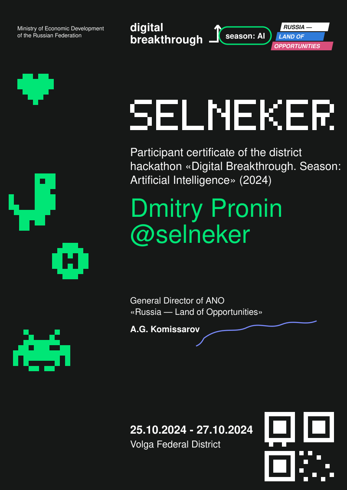

<!-- ✏️ CUSTOMIZE: replace name/dates inside assets/certificate.svg, and @selneker links below -->

  

  
  
  

🟩🟩🟩⬛🟩⬛🟩⬛🟩⬛🟩⬛🟩⬛🟩⬛🟩⬛🟩⬛🟩⬛🟩⬛🟩⬛🟩⬛🟩⬛🟩⬛

## 🟩 Participant stats

| 📊 &nbsp; GitHub stats | 🔥 &nbsp; Streak |
|:---:|:---:|
|  |  |

  

## 🟩 Stack

  
  
  
  
  
  

## 🟩 Contact

  
  
    
  

🟩⬛🟩⬛🟩⬛🟩⬛🟩⬛🟩⬛🟩⬛🟩⬛🟩⬛🟩⬛🟩⬛🟩⬛🟩⬛🟩⬛🟩⬛🟩⬛🟩⬛

made of 🟩 pixels • season: AI • 2024–2026

